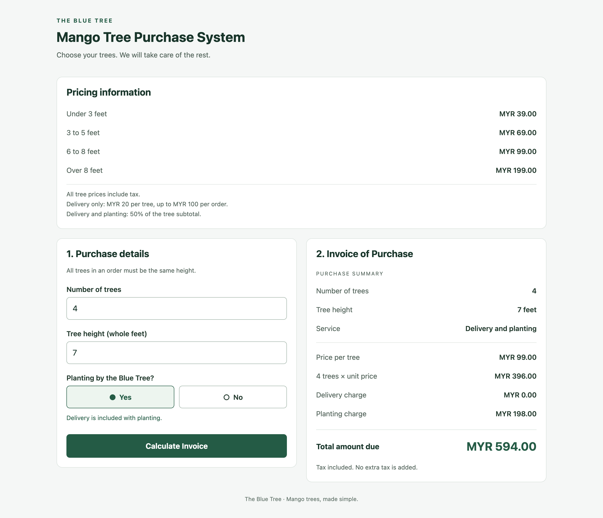
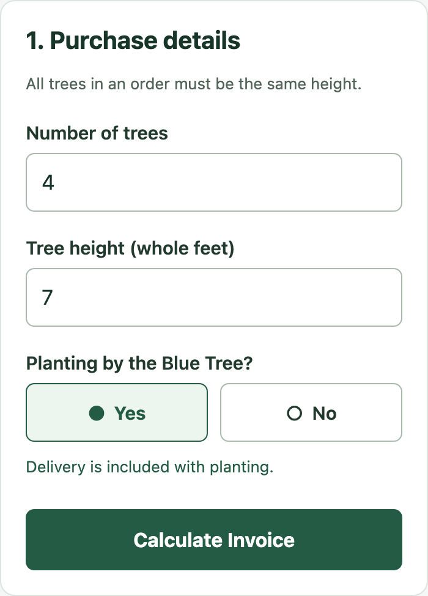
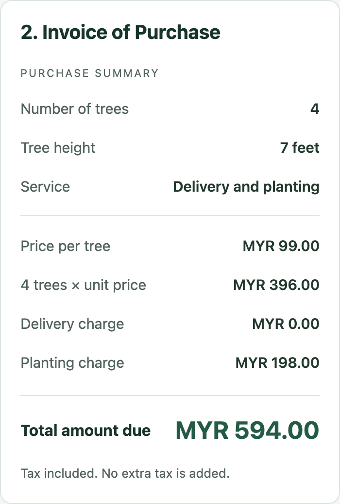

# The Blue Tree · Mango Tree Purchase System

A simple React Native app for pricing mango trees and choosing cash and carry, delivery, or delivery with planting. Built with **Expo SDK 58**, with the same screen running on mobile and the web.

[**Open the live demo →**](https://abdullahwarrg-png.github.io/blue-tree-mango/) · [**Download the Word report**](docs/Blue_Tree_Project_Report.docx) · [**Read the main page code**](App.js)




## Pricing rules

| Tree height | Price per tree, tax included |
| :--- | ---: |
| Under 3 feet | MYR 39.00 |
| 3–5 feet | MYR 69.00 |
| 6–8 feet | MYR 99.00 |
| Over 8 feet | MYR 199.00 |

| Service | Additional charge |
| :--- | :--- |
| Cash and carry | MYR 0.00 |
| Delivery only | MYR 20.00 per tree, capped at MYR 100.00 per order |
| Delivery and planting | 50% of tree subtotal; delivery included |

**Example:** four 7-foot trees cost MYR 396.00. Planting adds MYR 198.00 and delivery adds MYR 0.00, giving **MYR 594.00**.

Arithmetic uses integer sen. Inputs must be positive safe whole numbers; orders exceeding safe integer arithmetic are rejected. Height zero is invalid. This quotation app does not process payments or save orders.

## Run locally

Use Node.js 22 LTS (22.13 or later) and npm.

```sh
git clone https://github.com/abdullahwarrg-png/blue-tree-mango.git
cd blue-tree-mango
npm ci
npm run web
```

Open the URL printed by Expo. The web base path is `/blue-tree-mango`, matching GitHub Pages.

### Expo Go on a phone

```sh
npm start
```

Install an Expo Go version supporting **SDK 58**, connect the computer and phone to the same network, and scan the terminal QR code (Camera on iOS or Expo Go on Android). If local connections are blocked, use `npx expo start --tunnel` and follow Expo's prompt to install its tunnel helper.

The deliverable includes React Native source, not an APK. Browser tests emulate phone dimensions; physical iOS and Android device testing is not included.

### Production web preview

```sh
npm run build:web
npm run preview
```

Open [the local production preview](http://127.0.0.1:4173/blue-tree-mango/).

## Verification

```sh
npm run lint
npm run typecheck
npx expo-doctor
npm run build:web
npx playwright install chromium
npm test
```

**50 browser checks** cover desktop and phone configurations:

- Every price boundary and the MYR 594 sample.
- All three services and delivery below, at and above the five-tree cap.
- Blank, zero, negative, decimal, nonnumeric, exponential and unsafe inputs.
- Missing choices, delivery reset and invoice invalidation after edits.
- Keyboard completion, page errors and non-overlapping layouts at 320, 390, 800 and 1280 pixels.

GitHub Actions checks lint, JavaScript types, the production export and browser tests before deployment. On Linux, use `npx playwright install --with-deps chromium`.

The Expo-compatible toolchain currently has moderate upstream npm audit advisories in development tooling (`glob` and `minimatch`). The static demo has no server filesystem or user-supplied glob processing. Dependencies remain aligned with Expo; no breaking forced downgrade is applied.

## Project guide

| Location | Contents |
| :--- | :--- |
| `App.js` | Complete screen, validation, calculations and styles |
| `app.json` | Expo identity, mobile icon and web subpath |
| `tests/` | Browser acceptance tests |
| `scripts/` | Static preview server and export metadata |
| `.github/workflows/pages.yml` | Checks and GitHub Pages deployment |
| `docs/Blue_Tree_Project_Report.docx` | UI discussion, screenshots and exact main page code |
| `docs/screenshots/` | Actual captures of the running app |

<details>
<summary>Phone input and output screenshots</summary>




</details>

## Deployment

The demo is hosted at **https://abdullahwarrg-png.github.io/blue-tree-mango/**. Pushes to `main` trigger `.github/workflows/pages.yml`; pull requests run checks without deploying. GitHub Pages uses **GitHub Actions** as its build source. The export includes `.nojekyll` so `_expo` assets are served correctly.

For a fork, update `expo.experiments.baseUrl` in `app.json`, the preview prefix, test base URL and README links to match the new repository name.

## Licence

MIT; see [LICENSE](LICENSE). The Expo starter's original licence notice is retained.
